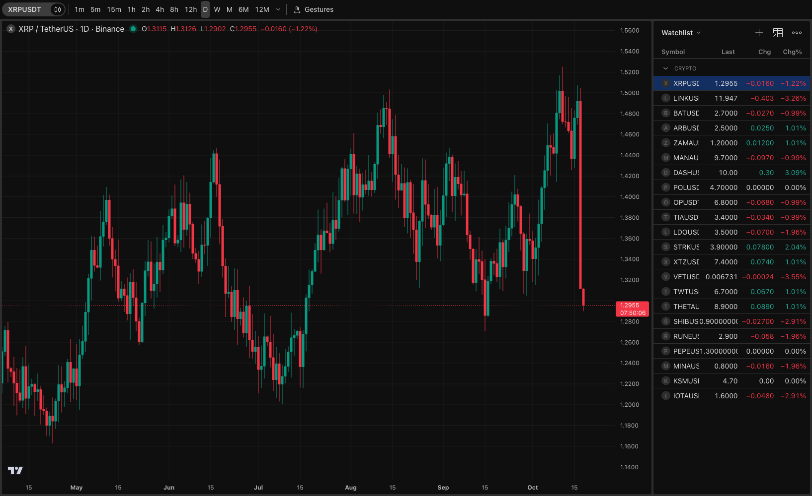
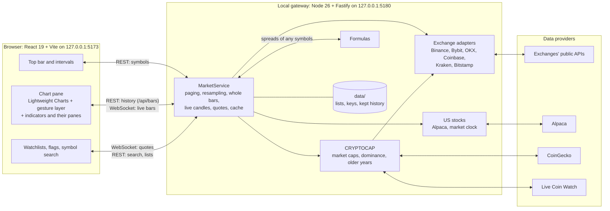
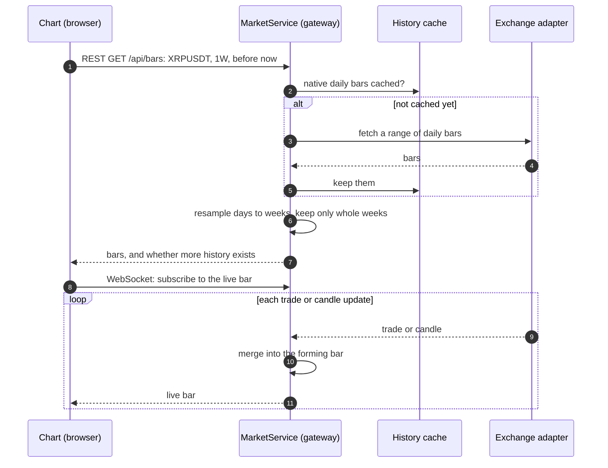
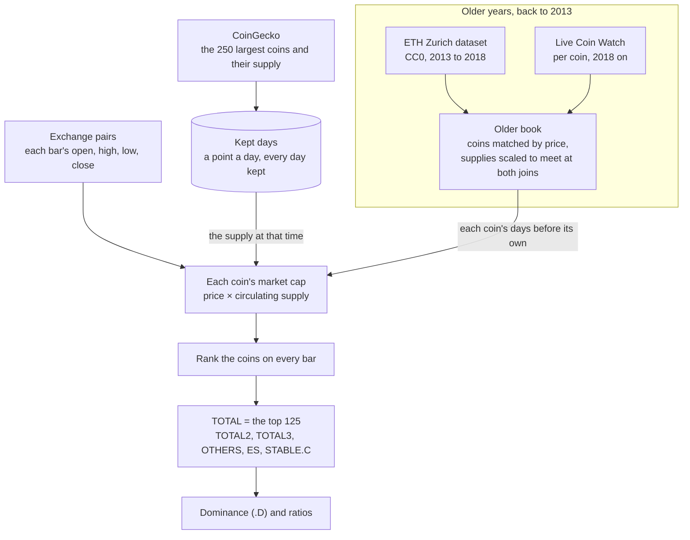
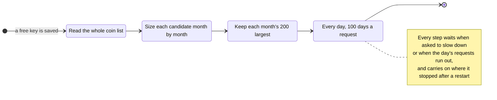
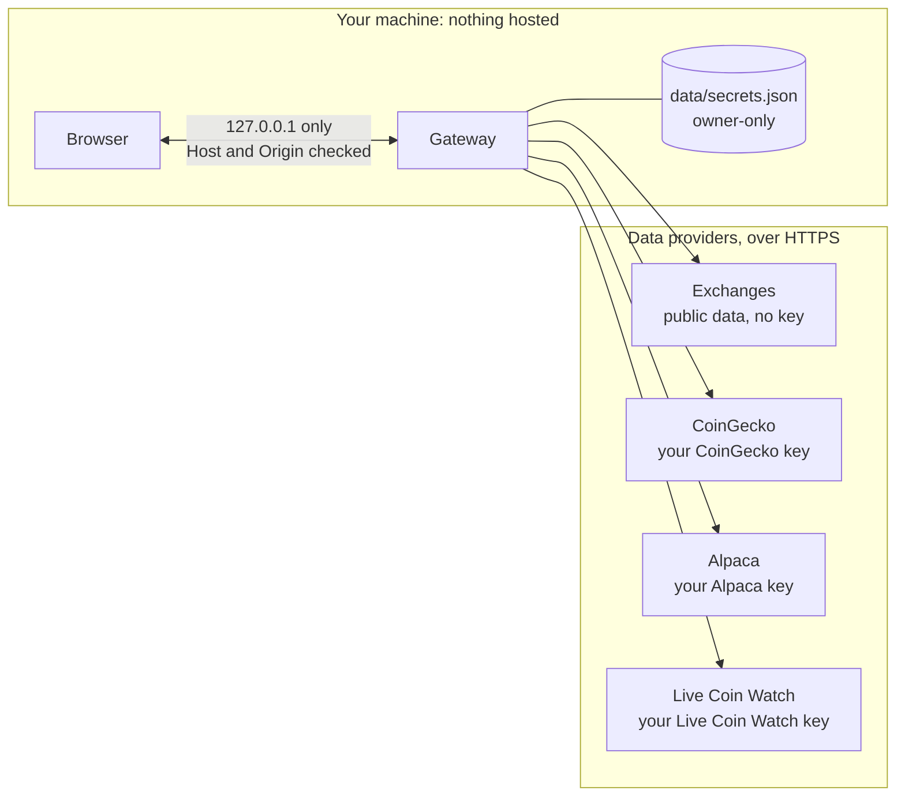
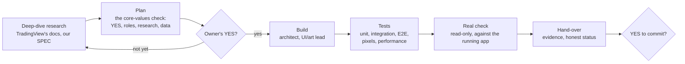

# tradingNerd

**A local-first, privacy-first rebuild of TradingView's chart page.** It aims to look and feel identical, and it's measured against TradingView pixel by pixel and number by number.




<sub>The chart page, as the browser tests render it on demo data (this image is one of their visual baselines).</sub>

---

## Why this project

TradingView sets the bar for charting: smooth trackpad gestures, a dense but calm interface, and market-wide indices such as TOTAL and BTC.D. tradingNerd rebuilds its chart page as a local app, and treats TradingView as the **benchmark, never the source**:

- **The feel:** gestures, zoom and scroll tuned against TradingView, with performance budgets enforced by tests.
- **The look:** sizes, colours and states measured from TradingView screenshots, then checked pixel by pixel.
- **The numbers:** market caps and dominance rebuilt from raw exchange prices and coin supplies, and checked against TradingView's figures to within 0.3% at the moments measured.
- **The privacy:** everything runs on your own machine with your own free API keys. Nothing is hosted, and no telemetry is collected.

## Highlights

| | |
|---|---|
| **Live markets** | Six crypto exchanges (Binance, Bybit, OKX, Coinbase, Kraken, Bitstamp) over their public REST and WebSocket APIs, plus every US-listed stock and ETF through Alpaca, with extended hours and the market clock |
| **Market-cap indices** | TOTAL, TOTAL2, TOTAL3, OTHERS, the ES variants, STABLE.C, every coin's own market cap, dominance and ratios, computed the way TradingView defines them: TOTAL2 at −0.19% against TradingView, BTC.D +0.07% |
| **Formulas** | Spreads such as `TOTAL2/XRPUSD` or `BTC.D+ETH.D`, typed into search, charted and kept in watchlists |
| **History** | Deep scroll-back with resampling to any interval, seconds and ticks, and only whole bars. Market caps go back to 2013 through a resumable, rate-limit-aware download and a CC0 academic dataset |
| **Watchlists** | Several lists, sections, flags, multi-select, drag and drop, and TradingView's own `.txt` import and export |
| **Indicators** | TradingView's Indicators button and dialog with favorites; Volume and RSI computed as Pine computes them, live and through history, with their legend rows, settings and panes. A value is drawn only where the loaded bars settle it, never one that differs from TradingView's for want of older bars |
| **Performance** | 60 fps panning and zooming through 20,000 bars; under 2 ms a frame with 50 rows ticking; symbol and interval switches under 150 ms, all enforced by tests |
| **Quality** | About 1,160 unit and integration tests and 210 end-to-end tests, including pixel comparisons against TradingView reference screenshots |
| **Security** | A loopback-only gateway with Host and Origin checks, owner-only key storage, keys masked to the browser, and no outside requests from the browser |

## Architecture

A browser app and a local gateway, both bound to `127.0.0.1`. The gateway is the only part that talks to the outside world, and it talks only to the data providers. Between the two, REST carries history (`/api/bars`), search, lists and keys; one WebSocket carries the live bars, quotes and best bid and ask.



| Part | Responsibility |
|---|---|
| [`apps/web`](apps/web) | The screen: app shell, chart pane, interval bar, watchlists, symbol search, dialogs |
| [`packages/chart`](packages/chart) | The chart engine around Lightweight Charts: the gesture layer (wheel, trackpad, keyboard, drag), plugins (crosshair, last price, extended hours, session shading), indicators' series and panes |
| [`packages/indicators`](packages/indicators) | TradingView's built-in indicators as Pine computes them: the `ta.*` functions, Volume and RSI, bar by bar and live |
| [`packages/core`](packages/core) | Shared by both sides: the protocol, intervals and the resampler, the market clock, formulas, watchlist files |
| [`apps/gateway`](apps/gateway) | Exchange adapters, the market service and its cache, search, US stocks, CRYPTOCAP, formulas, logos, storage |

The map of the code, folder by folder, is in [docs/ARCHITECTURE.md](docs/ARCHITECTURE.md); the reasoning behind each choice is in [docs/SPEC.md](docs/SPEC.md).

### How a chart loads



History comes over REST; the WebSocket carries only what's live. Scrolling back asks `/api/bars` for the next page. After a dropped connection, the gateway tells the chart to reload recent history, so no bar goes missing.

### How market caps are built (CRYPTOCAP)

TradingView's indices are sums over the largest coins. tradingNerd rebuilds them from first principles: each coin's market cap is its exchange price times its circulating supply at that moment.



### The long-history download

Live Coin Watch's free plan allows 10,000 requests a day, with an unpublished pace limit. The download runs in the background for a few days, survives restarts, and never asks twice for anything it already has.



The candidates are looked at in groups, most likely first. A group is given up once 1,000 coins in a row never come near a month's 250 largest, which saves thousands of requests on long-dead tokens.

## Accuracy: measured, not guessed

Every number is compared with TradingView's before it ships. Where TradingView doesn't document a behaviour, the choice is marked provisional and calibrated against screenshots.

| Check | Result |
|---|---|
| TOTAL, TOTAL2, TOTAL3 against TradingView at the same minute | −0.10%, −0.19%, −0.26% |
| BTC.D, ETH.D, USDT.D | +0.07%, +0.05%, +0.10% |
| The formula `BTC.D+ETH.D+USDT.D+USDC.D` | +0.07% |
| The formula `TOTAL2/XRPUSD` (Bitstamp's XRP) | −0.12% to −0.16% |
| The screenshot ruler on our own last year | median −0.2% |

**The screenshot ruler** ([tools/accuracy](tools/accuracy)) reads a TradingView weekly chart off a screenshot, pixel column by pixel column. It calibrates the price grid and the time axis from the image, then draws our weekly highs into the same columns. It's how older years are judged: Live Coin Watch's whole-market totals read +2% to +12% high from 2019 to 2024, so the per-coin rebuild above is under way, with a pass mark of ±3% in each year.

## Security and privacy



- **Not reachable from the network.** Both servers bind to `127.0.0.1`. Every request must carry a loopback `Host`, and an allowed `Origin` if any, which shuts out other websites and DNS rebinding.
- **Keys:**
  - each is checked with its provider before it's kept;
  - they're stored owner-only (`-rw-------`);
  - the browser sees them only masked;
  - they're sent only in request headers, each to its own provider;
  - no log line prints one.
- **The browser loads nothing from outside:** no fonts, CDNs, analytics or trackers. Logos are fetched by the gateway and served from disk.
- **Your data stays local.** Watchlists, settings and downloaded history live in `data/`, which is git-ignored and has never been committed.

The full model and the checks to run are in [docs/SECURITY.md](docs/SECURITY.md).

## How it's built

tradingNerd is built by its owner with an AI engineering agent ([Claude Code](https://claude.com/claude-code)), under a written operating model. The owner sets the direction and approves every change. The agent researches, designs, builds, tests and reports, inside explicit rules:



- **[CLAUDE.md](CLAUDE.md):** the owner's five core values:
  1. YES before any change.
  2. Work in roles.
  3. Deep-dive research first.
  4. Core values first.
  5. The best data for every chart.
- **[AGENTS.md](AGENTS.md):** the standing rules for any AI agent. Never show wrong data, never hide data, git and key handling, and the definition of done.
- **[docs/SPEC.md](docs/SPEC.md):** the source of truth. A dated decision log, research with measured facts, requirements, architecture, the delivery plan, tests and open questions.
- **[docs/HANDOVER.md](docs/HANDOVER.md):** where the work stands, updated at every hand-over.

## Tech stack

| Layer | Choice |
|---|---|
| Chart | [Lightweight Charts](https://github.com/tradingview/lightweight-charts) 5.2 with our own plugins and gesture layer |
| UI | React 19, TypeScript 7, Vite 8, CSS Modules and CSS variables |
| Gateway | Node 26 (TypeScript run directly, no build step), Fastify 5, ws |
| Storage | JSON files written atomically, an in-memory history cache |
| Quality | Biome, Vitest, Playwright (end-to-end, visual and performance tests) |
| Monorepo | pnpm workspaces |

## Repository layout

```
apps/web             React app: chart, toolbar, watchlists, search, dialogs
apps/gateway         Local server: exchanges, market service, CRYPTOCAP, US stocks
packages/core        Shared protocol, intervals, resampling, market clock, formulas
packages/chart       Chart engine: Lightweight Charts wrapper, gestures, plugins, indicator panes
packages/indicators  Built-in indicators as Pine computes them (Volume, RSI)
docs/                SPEC (source of truth), architecture, security, hand-over
docs/reference/      TradingView screenshots used for pixel comparisons
tools/accuracy/      The screenshot ruler for checking older history
AGENTS.md, CLAUDE.md The operating rules for AI agents and the owner's core values
```

## Getting started

You'll need [Node.js 26](https://nodejs.org) and pnpm 12.4.1. Node 26 no longer ships Corepack, so pnpm is installed with npm. It's developed and tested on macOS.

```sh
git clone https://github.com/iamdebasis/TradingNERD.git
cd TradingNERD
npm install -g pnpm@12.4.1
pnpm install
pnpm dev            # gateway on 127.0.0.1:5180, app on http://127.0.0.1:5173
```

Crypto charts work straight away from the exchanges' public APIs. Three free keys unlock the rest; each goes into its own dialog in the app:

| Key (free) | Unlocks |
|---|---|
| [CoinGecko](https://www.coingecko.com/en/developers/dashboard) Demo | Coin logos and the CRYPTOCAP indices |
| [Alpaca](https://app.alpaca.markets/signup) | US stocks and ETFs, 15 minutes delayed |
| [Live Coin Watch](https://www.livecoinwatch.com/tools/api) | Market caps before the last year, back to 2013 |

## Testing

```sh
pnpm verify         # typecheck, lint, unit and integration tests, end-to-end tests
pnpm test           # unit and integration tests only
pnpm test:e2e       # Playwright: behaviour, pixels, performance
pnpm test:live      # opt-in checks against the real exchanges
```

| Suite | Tests |
|---|---|
| `packages/core` | 339 |
| `packages/indicators` | 73 |
| `packages/chart` | 64 |
| `apps/web` (unit) | 166 |
| `apps/gateway` | 517, plus 66 live tests |
| End to end (Playwright) | 210 |

The end-to-end suite runs against a fake gateway and fakes every write. It includes pixel comparisons against TradingView's own screenshots and performance budgets.

## Roadmap

- **Each coin's older days (M9f, under way):** every CRYPTOCAP symbol back to 2013, switched on once the accuracy test passes.
- **More indicators:** moving averages, Bollinger Bands and VWAP (I2); MACD, Stochastic, ATR and TradingView's pane controls (I3); templates and saved defaults (I4).
- Kraken's full history from its downloadable files.
- Gold and silver for spreads such as BTCUSD/XAUUSD.
- TradingView-style watchlist columns that widen to fit.
- Stock logos.

The full list, with every provisional choice, is in [docs/SPEC.md §11](docs/SPEC.md#11-open-questions-and-parity-checklist).

## Acknowledgements and data sources

- **Charts:** [Lightweight Charts™](https://github.com/tradingview/lightweight-charts) by TradingView, Apache 2.0.
- **Market data:** the public APIs of Binance, Bybit, OKX, Coinbase, Kraken and Bitstamp; [Alpaca](https://alpaca.markets) for US stocks; [Nasdaq Trader](https://www.nasdaqtrader.com)'s symbol directory.
- **Coin data:** [CoinGecko](https://www.coingecko.com) and [Live Coin Watch](https://www.livecoinwatch.com), both credited in the app.
- **Historical market caps:** Wu, Wheatley and Sornette's dataset of CoinMarketCap's daily figures ([Zenodo 4946058](https://zenodo.org/records/4946058), CC0; *Royal Society Open Science*, 2018).

Data is fetched on your machine with your own keys and isn't redistributed by this repository.

## Disclaimer

tradingNerd is a personal, non-commercial engineering project, built to learn and to demonstrate. It isn't affiliated with, endorsed by or connected to TradingView, Inc. "TradingView" is a trademark of TradingView, Inc.; it's referred to here only to describe what the project measures itself against. tradingNerd uses no TradingView data and no TradingView code, apart from the open-source Lightweight Charts library. The screenshots in `docs/reference/` are used only for side-by-side measurement. Nothing here is financial advice.
